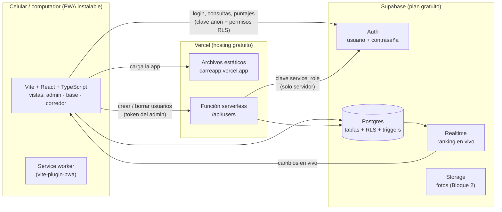
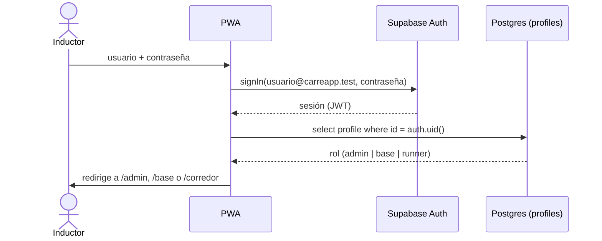
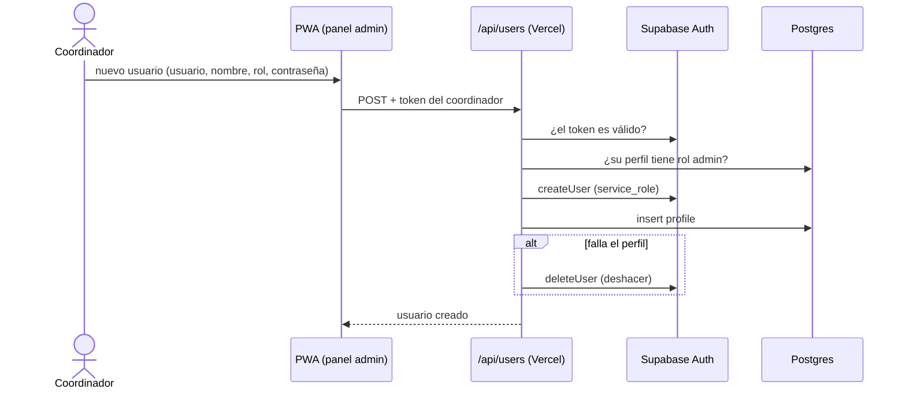
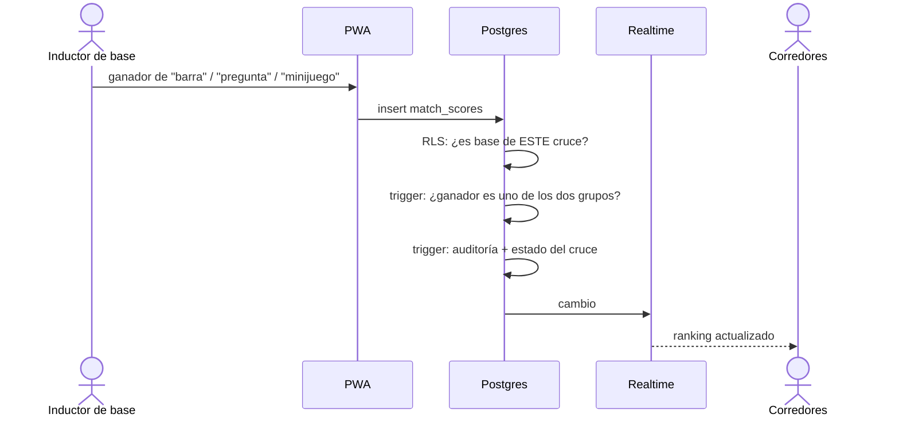

# Arquitectura

## Componentes



## Por qué hay una función serverless
Crear o borrar usuarios requiere la clave **`service_role`** de Supabase, que da acceso total y **nunca debe llegar al navegador**. Por eso esa operación vive en `api/users.ts` (Vercel): la función verifica que quien llama sea **admin** y recién ahí usa la clave.

## Inicio de sesión
Supabase Auth exige correo, pero los inductores entran con **usuario y contraseña**. Cada usuario se guarda como `usuario@carreapp.test` (dominio reservado que no existe) y la app lo convierte automáticamente.



## Crear un usuario (solo admin)



## Puntuar un enfrentamiento (base)



## Estructura del repositorio

```
api/                      Funciones serverless (Vercel)
  users.ts                Crear / cambiar contraseña / eliminar usuarios
src/
  lib/                    Cliente Supabase, autenticación, utilidades
  components/             RequireRole (guard de rutas), AppShell
  pages/                  Login, AdminHome, BaseHome, RunnerHome, NetworkCheck
supabase/
  migrations/             Scripts SQL numerados (ver Registro SQL)
  seed_admin.sql          Crea el primer administrador
docs/wiki/                Fuente de esta wiki (se sincroniza con la wiki de GitHub)
```
