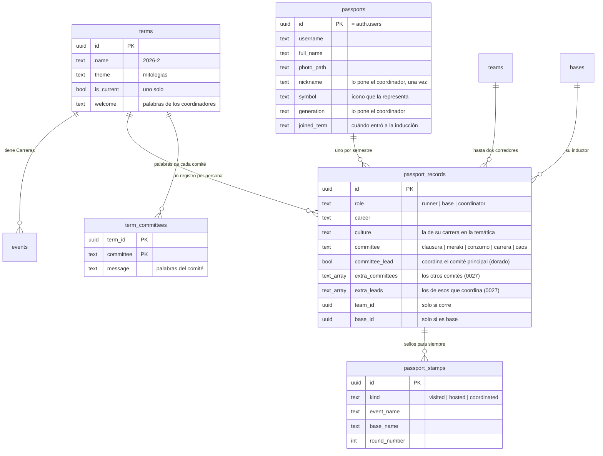

# Modelo de datos

Definido en [`supabase/migrations/0001_initial_schema.sql`](https://github.com/zdan13l/CarreApp/blob/main/supabase/migrations/0001_initial_schema.sql).

## Diagrama entidad-relación

```mermaid
erDiagram
  events ||--o{ teams : tiene
  events ||--o{ bases : tiene
  events ||--o{ matches : tiene
  profiles ||--o{ base_staff : atiende
  bases ||--o{ base_staff : "es atendida por"
  bases ||--o{ base_questions : "hasta 3"
  bases ||--o| base_details : "información privada"
  teams ||--o| team_locations : "última ubicación"
  teams ||--o{ team_runners : "es acompañado por"
  profiles ||--o{ team_runners : corre
  bases ||--o{ matches : "se juega en"
  teams ||--o{ matches : "team_a / team_b"
  matches ||--o{ match_scores : "3 ítems"
  teams ||--o{ match_scores : gana
  matches ||--o{ score_audit : registra

  events {
    uuid id PK
    text name
    bool is_active "solo una activa: es phase distinto de disabled"
    text phase "disabled, enabled, started o finished (0032)"
    timestamptz started_at "al iniciar (0032)"
    timestamptz finished_at "al terminar (0032)"
  }
  profiles {
    uuid id PK "= auth.users.id"
    text username UK
    text full_name
    enum role "admin | base | runner"
  }
  teams {
    uuid id PK
    uuid event_id FK
    text name
    text photo_path
  }
  bases {
    uuid id PK
    uuid event_id FK
    text name
    text location_photo_path "foto del lugar"
    float lat "ubicación en el mapa"
    float lng
  }
  team_locations {
    uuid team_id PK_FK
    float lat
    float lng
    timestamptz updated_at "última ubicación del corredor GPS"
  }
  base_details {
    uuid base_id PK_FK
    text info "información que se da; PRIVADA (admin y su base)"
  }
  base_questions {
    uuid base_id FK
    smallint position "1 a 3"
    text question "PRIVADAS (admin y su base)"
  }
  base_staff {
    uuid base_id FK
    uuid user_id FK
  }
  team_runners {
    uuid team_id FK
    uuid user_id FK
    bool is_gps_tracker "solo uno por grupo"
  }
  matches {
    uuid id PK
    uuid base_id FK
    int round_number
    uuid team_a FK
    uuid team_b FK
    enum status "pending | in_progress | finished"
  }
  match_scores {
    uuid match_id FK
    enum item "barra | pregunta | minijuego"
    uuid winner_team_id "obligatorio salvo ítem invalidado"
    uuid awarded_by FK
  }
  score_audit {
    bigint id PK
    uuid match_id
    text action "insert | update | delete"
    uuid old_winner
    uuid new_winner
    uuid changed_by
  }
```

## Pasaporte personal (migración 0023)



**Generaciones (0039):** `generations` es un catálogo global y permanente (clave = nombre sin tildes, semestre de entrada, sello de siempre y sello editado: forma, color, imagen). `passports.generation` guarda los nombres exactos del catálogo (uno, o dos separados por « / ») y un disparador rechaza lo que no esté; una generación con personas no se borra ni se renombra.

## Reglas de negocio (las hace cumplir la base de datos)

| Regla | Cómo se garantiza |
|---|---|
| Dos grupos **no se enfrentan más de una vez** en toda la Carrera (sin importar el orden) | Índice único sobre `(event_id, least(team_a, team_b), greatest(team_a, team_b))` |
| Un grupo **no puede estar en dos bases** en la misma ronda | Trigger `validate_match` |
| Una base atiende **un solo cruce por ronda** | `unique (base_id, round_number)` |
| Un grupo no se enfrenta a sí mismo | `check (team_a <> team_b)` |
| Los grupos y la base de un cruce son de la **misma Carrera** | Trigger `validate_match` |
| Cada ítem se puntúa **una sola vez** por cruce | `unique (match_id, item)` |
| El ganador es **uno de los dos grupos** del cruce (siempre hay ganador) | Trigger `validate_score` |
| Una base solo puntúa **sus** cruces | Política RLS `scores_base_insert` |
| Solo el coordinador **corrige o borra** puntajes | Políticas RLS (solo admin en update/delete) |
| Todo cambio de puntaje queda **auditado** | Trigger `after_score_change` → `score_audit` |
| El estado del cruce se actualiza solo (1–2 ítems = en juego, 3 = terminado) | Trigger `after_score_change` |
| Solo una Carrera activa a la vez | Índice único parcial en `events(is_active)` |
| Estados de la Carrera y pasos válidos | `events.phase` + trigger `events_a_sync_phase` + `event_action()` (0032) |
| Una base solo actúa con la Carrera Iniciada | `staff_can_act()` en las políticas y funciones de escritura (0032) |
| Solo un corredor transmite GPS por grupo | Índice único parcial en `team_runners(team_id)` |
| Un comité puede tener **varios coordinadores** (Caos tiene dos), todos con sello dorado | Sin índice único desde 0026 (antes lo había, 0024) |
| Nadie edita su propio pasaporte (todo lo pone el coordinador; el @ y la contraseña los cambia el servidor) | Sin política de escritura para la persona y disparador `passports_guard` (0025) |
| Un solo semestre vigente | Índice único parcial en `terms(is_current)` |
| Una persona tiene **un registro por semestre**; un grupo tiene **dos personas como máximo**, del mismo semestre | `unique (passport_id, term_id)` y trigger `validate_passport_record` |
| Los sellos del pasaporte se archivan **antes** de reiniciar la Carrera | Trigger `events_archive_stamps` (alfabéticamente antes que `events_reset_on_deactivate`) |
| Al desactivar, los puntajes se guardan en el historial (`event_archives`, con nombres) antes del reinicio | Trigger `events_archive_scores` (0028, antes de `events_archive_stamps` y `events_reset_on_deactivate`) |

## Ranking
La vista `team_standings` suma los puntos de cada grupo (cada `match_scores` ganado = 1 punto). Es `security_invoker`, o sea que respeta los permisos de quien consulta.

## Cosas que **aún no** valida la base de datos (se validarán en la app)
- Que todos los grupos y bases tengan **nombre y foto** antes de activar la Carrera (las columnas de foto aceptan `null` mientras se edita).
- Que todos los grupos jueguen contra todos o cumplan el cronograma completo (Bloque 3).
