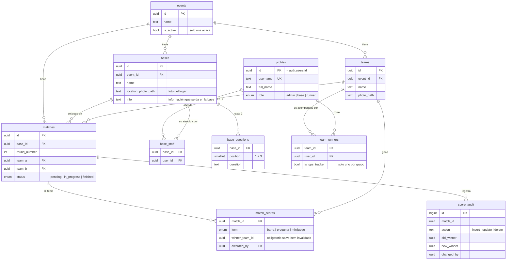

# Modelo de datos

Definido en [`supabase/migrations/0001_initial_schema.sql`](https://github.com/zdan13l/CarreApp/blob/main/supabase/migrations/0001_initial_schema.sql).

## Diagrama entidad-relación

## Reglas de negocio (las hace cumplir la base de datos)

| Regla | Cómo se garantiza |
|---|---|
| Dos grupos **no se enfrentan más de una vez** en toda la Carrera (sin importar el orden) | Índice único sobre `(event_id, least(team_a, team_b), greatest(team_a, team_b))` |
| Un grupo **no puede estar en dos bases** en la misma ronda | Trigger `validate_match` |
| Una base atiende **un solo cruce por ronda** | `unique (base_id, round_number)` |
| Un grupo no se enfrenta a sí mismo | `check (team_a <> team_b)` |
| Los grupos y la base de un cruce son de la **misma Carrera** | Trigger `validate_match` |
| Cada ítem se puntúa **una sola vez** por cruce | `unique (match_id, item)` |
| El ganador es **uno de los dos grupos** del cruce (siempre hay ganador) | Trigger `validate_score` |
| Una base solo puntúa **sus** cruces | Política RLS `scores_base_insert` |
| Solo el coordinador **corrige o borra** puntajes | Políticas RLS (solo admin en update/delete) |
| Todo cambio de puntaje queda **auditado** | Trigger `after_score_change` → `score_audit` |
| El estado del cruce se actualiza solo (1–2 ítems = en juego, 3 = terminado) | Trigger `after_score_change` |
| Solo una Carrera activa a la vez | Índice único parcial en `events(is_active)` |
| Solo un corredor transmite GPS por grupo | Índice único parcial en `team_runners(team_id)` |

## Ranking
La vista `team_standings` suma los puntos de cada grupo (cada `match_scores` ganado = 1 punto). Es `security_invoker`, o sea que respeta los permisos de quien consulta.

## Cosas que **aún no** valida la base de datos (se validarán en la app)
- Que todos los grupos y bases tengan **nombre y foto** antes de activar la Carrera (las columnas de foto aceptan `null` mientras se edita).
- Que todos los grupos jueguen contra todos o cumplan el cronograma completo (Bloque 3).
